  <!-- Header Banner -->
  

  <h3>Full-Stack Web Developer & Computer Science Engineering Student</h3>
  
<i>Information Systems Engineering (ISI) @ ENICarthage</i>

  

    Building high-performance, secure web applications with a focus on system architecture, database security (PostgreSQL RLS), and modern developer tooling.
  

  <!-- Social & Contact Pill Badges -->
  

    
    
  

---

### Overview

- **Academic Profile:** Pursuing an Engineering Degree in Computer Science (Information Systems Engineering - ISI) at **ENICarthage** (Ranked Top 10 in 1st Year). Previously graduated **top of class twice** at ISTIC (16.72/20 average).
- **Full-Stack Engineering:** Specializing in React 19, Next.js, Tailwind CSS v4, Supabase, and PostgreSQL backend architecture.
- **Design Background:** 4+ years of branding and visual design experience. I translate design systems and brand identities directly into responsive React components.
- **AI Tooling & Integration:** Anthropic-certified in Claude API and Model Context Protocol (MCP). Focused on building AI-augmented workflows and secure RBAC/RLS database policies.

---

### Technical Stack & Capabilities

<table>
  <tr>
    <td valign="top" width="25%"><b>Frontend & UI</b></td>
    <td width="75%">
      
      
      
      
      
    </td>
  </tr>
  <tr>
    <td valign="top" width="25%"><b>Backend & Databases</b></td>
    <td width="75%">
      
      
      
      
      
    </td>
  </tr>
  <tr>
    <td valign="top" width="25%"><b>Infrastructure & Cloud</b></td>
    <td width="75%">
      
      
      
      
      
    </td>
  </tr>
  <tr>
    <td valign="top" width="25%"><b>AI & Security</b></td>
    <td width="75%">
      
      
      
      
    </td>
  </tr>
</table>

---

### Featured Engineering Work

#### Khansa Academy — Full-Stack E-Learning Platform
> **Solo Full-Stack Engineer** • 3-Week Development Cycle • [khansaacademy.com](https://khansaacademy.com)
- **Architecture:** Engineered end-to-end e-learning platform featuring 60+ Postgres Row-Level Security (RLS) policies, anti-piracy signed video streaming via Bunny.net CDN, custom OKLCH design tokens, and automated payment validation.
- **Tech Stack:** `React 19` `Supabase` `PostgreSQL RLS` `Tailwind CSS v4` `Bunny.net CDN` `Railway`

---

#### Enterprise HR & Payroll Platform (SASCODE)
> **Full-Stack Internship Project** • Enterprise Web Application
- **Architecture:** Co-engineered a centralized HR system digitizing attendance, leave management, and payroll. Integrated physical biometric hardware devices for automated employee attendance logging.
- **Tech Stack:** `React` `Django` `PostgreSQL` `Material-UI` `UML Modeling`

---

#### AI Traffic Vision & Speed Estimation System
> **Computer Vision Engineering** • Academic Top Class Honors
- **Architecture:** Built a real-time computer vision pipeline for automated vehicle speed estimation and regional license plate recognition.
- **Tech Stack:** `Python` `YOLOv8` `Roboflow` `EasyOCR` `OpenCV`

---

### Development Activity & Metrics

  
  

